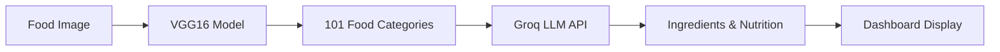

# 🍔 Food Image Recipe Generator

<div align="center">


**AI-Powered Food Recognition & Nutrition Generator**

[]()
[](https://github.com/samalarakshithbabu/food-image-recipe-generator/issues)

</div>

---

## 🚀 Executive Summary

An **AI-powered web application** that identifies food from images and generates instant ingredient lists and nutrition facts using deep learning (VGG16) and the Groq LLM (LLaMA 3.3). Just snap a photo and learn what's on your plate!

### What It Does



---

## ✨ Key Features

| Feature | Description |
|---------|-------------|
| **Food Recognition** | Classifies from 101 food categories |
| **VGG16 Deep Learning** | Custom-trained CNN model |
| **Smart Ingredient Generation** | Groq LLM (LLaMA 3.3 70B) |
| **Nutrition Facts** | AI-generated nutritional information |
| **Modern UI** | Responsive HTML + Tailwind CSS |

---

## 🧠 Model Details

| Aspect | Details |
|--------|---------|
| **Architecture** | VGG16 (no top layers) |
| **Dataset** | Food-101 with augmentations |
| **Classes** | 101 food categories |
| **Training** | ~80 epochs, batch size 16 |

---

## 🛠️ Technology Stack

| Component | Technology | Purpose |
|-----------|------------|---------|
| **Backend** | Python + Flask | Web server |
| **Deep Learning** | TensorFlow/Keras | VGG16 model |
| **LLM** | Groq API | Ingredient generation |
| **Frontend** | HTML + TailwindCSS | UI |

---

## 📁 Project Structure

```
food-image-recipe-generator/
├── app.py                          # Flask backend
├── model.py                        # Model architecture & training
├── vgg16_food101_trained.h5       # Trained model weights
├── templates/
│   └── index.html                  # Dashboard UI
├── static/                         # Styles/images
├── api.txt                         # API key & labels
└── README.md                       # This file
```

---

## 🛠️ Installation

### Prerequisites
- Python 3.8+
- Groq API key

### Setup
```bash
git clone https://github.com/samalarakshithbabu/food-image-recipe-generator.git
cd food-image-recipe-generator
pip install -r requirements.txt

# Set Groq API key in api.txt or environment
python app.py
```

---

## ⚠️ Limitations

| Limitation | Description |
|------------|-------------|
| **Model File** | vgg16_food101_trained.h5 may be large |
| **API Key Required** | Groq API key needed for nutrition |
| **Accuracy** | Claims not independently verified |

---

## 📄 License

This project is licensed under the MIT License.

---

## 👨‍💻 Author

**SAMALA RAKSHITH BABU**

- 📧 Email: samalarakshithbabu7@gmail.com
- 💼 LinkedIn: [samala-rakshith-babu](https://www.linkedin.com/in/samala-rakshith-babu/)
- 🐙 GitHub: [samalarakshithbabu](https://github.com/samalarakshithbabu)